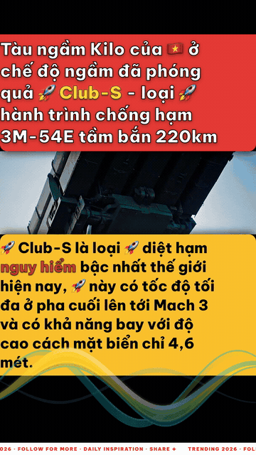

# 👨‍💻 Huy Le (Michael Huy)
### Senior Full-Stack & AI Systems Architect · Generative Media & Desktop Specialist

  

---

### 🚀 About Me

I am a **Senior Full-Stack & AI Systems Architect** with over a decade of engineering experience, specializing in **Generative Media (AI Video & Neural Audio)**, **Autonomous Multi-Agent Pipelines**, and **High-Performance Web & Desktop Platforms**.

Throughout my career, I have designed and delivered scalable enterprise solutions for international clients across the US, Australia, and Vietnam (CSC, Global CyberSoft, NxComm). Today, my core focus is pushing the frontier of **Programmatic Media Generation**—bridging large language models, dynamic timeline video engines, and desktop-class architectures.

- 🤖 **Agentic AI & LLMs**: Architecting orchestrated multi-agent workflows (Google Gemini API, Claude, OpenAI) for automated video script generation, multimodal QA, and intelligent content factories.
- 🎬 **Generative Video & Audio**: Engineering high-throughput programmatic rendering pipelines using **Remotion v4**, native **FFmpeg**, and emotional neural voice synthesis (**VieNeu-TTS / OmniVoice**).
- ⚡ **Modern Web & Cross-Platform Desktop**: Building reactive, high-performance platforms with **Next.js 16 App Router**, **React 19**, and cross-platform desktop applications powered by **Electron v45+** & **Vite**.
- 🛠️ **DevOps, VPS & Release Engineering**: Managing self-hosted **Linux VPS** infrastructure (Nginx reverse proxy, audio caching, systemd daemons, automated SSL), **GitHub Actions** CI/CD pipelines, and automated app store delivery via **Fastlane** (Apple App Store & Google Play).
- 📐 **High-Scale SaaS Architecture**: Crafting unified atomic storage vaults, zero-downtime session locks, and entitlement/quota engines scaled for high-concurrency workloads.

---

### 🎬 Programmatic Video & Generative Media Demo

<!-- Autoplaying High-Res Showreel: 100% compatible on Web & GitHub Mobile -->

  <b>Remotion 4.0.537 Programmatic Video Pipeline</b> 
  Dynamic 9:16 layout for TikTok/Shorts · Kinetic typography & keyword highlight · Neural voiceover sync

<!-- 
TIP: To enable the native HTML5 player with sound on GitHub:
1. Drag & drop 'assets/remotion-demo.mp4' into any GitHub issue or PR comment.
2. Copy the generated CDN URL (https://github.com/user-attachments/assets/...)
3. Replace the link below and uncomment:

<video src="https://github.com/user-attachments/assets/YOUR_ATTACHMENT_ID.mp4" width="340" controls></video>
-->

---

### 🛠️ Tech Stack & Engineering Arsenal

#### 🤖 AI, Multi-Agent Orchestration & Media Engine

#### 💻 Frontend & Cross-Platform Desktop

-000000?style=flat-square&logo=nextdotjs&logoColor=white)

#### 🚀 DevOps, CI/CD & Linux VPS Infrastructure

#### ☁️ Cloud, Databases & SaaS Storage Vault

-FFCA28?style=flat-square&logo=firebase&logoColor=black)

---

### 🏗️ Featured Architecture Case Studies

#### 1. HDAI Studio & HDAIPro Desktop — AI Generative Video Suite
- **Mission**: An end-to-end studio for automated short-form video generation (TikTok, Shorts, Reels) from news articles and e-commerce feeds.
- **Key Architecture**:
  - **Single Source of Truth**: Shared component tree and design tokens between Web (Next.js 16) and Desktop (Electron 45 / Vite).
  - **Programmatic Remotion Pipeline**: 1080×1920 9:16 layout, dynamic typography scaling, kinetic captions, and audio reactivity.
  - **Unified Vault**: Atomic writes, zero-downtime session locking, and isolated profile publishing automation.

#### 2. Multi-Agent Content & SEO Production Factory
- **Role-Based Pipelines**: Autonomous agent swarm (Orchestrator → Product Researcher → Angle Matrix → Script Writer → Multi-Tier Evidence QA).
- **Voice Intelligence**: Seamless integration with neural TTS systems with Vietnamese emotion markup (`[cười]`, `[thở dài]`) and non-verbal pacing controls.

#### 3. Enterprise CI/CD & Self-Hosted Linux VPS Automation
- **Zero-Downtime Linux VPS Pipelines**: Custom self-relocating bash deployments, Nginx reverse proxy with audio stream caching, SSL Certbot automation, and systemd process supervision.
- **Cross-Platform Matrix CI/CD**: GitHub Actions workflows building and packaging Electron desktop distributions across macOS (`arm64`/`universal`), Linux (`x64`), and Windows.
- **Mobile Store Delivery**: Automated build signing, credential provisioning, and store releases to Apple App Store & Google Play via Fastlane.

---

### 📊 GitHub Activity & Metrics

  
  

  

---

### 🏸 Personal Trivia
- 🏸 Badminton enthusiast & fan of Kento Momota's disciplined defensive craft.
- 💡 Continuous learner passionate about optimizing token pipelines, concurrent React patterns, and native OS integrations.

  Built with ❤️ by Huy Le · Updated for 2026 Tech Standards

